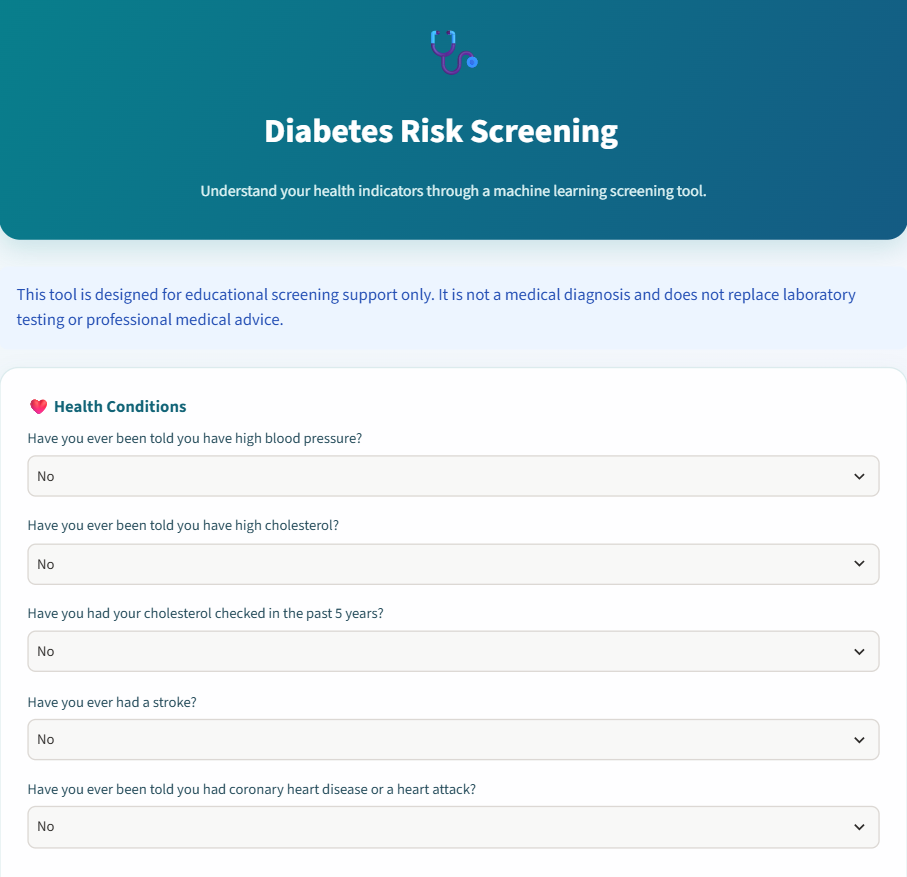
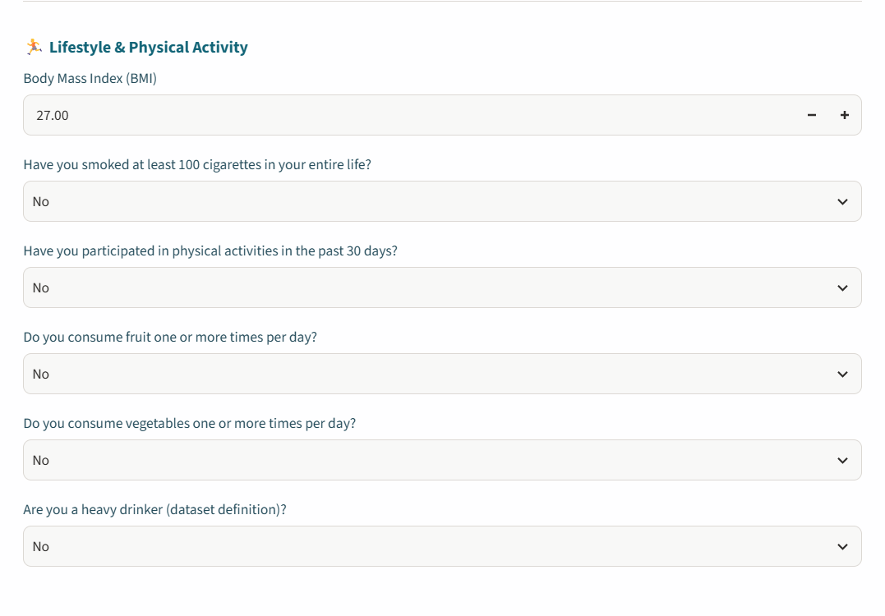
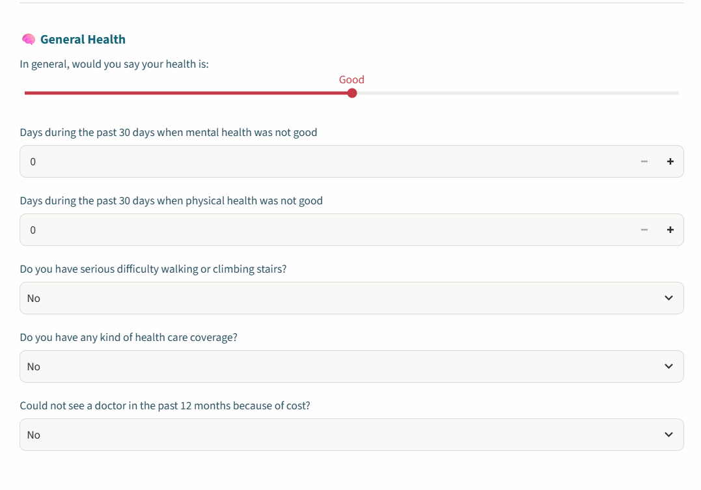
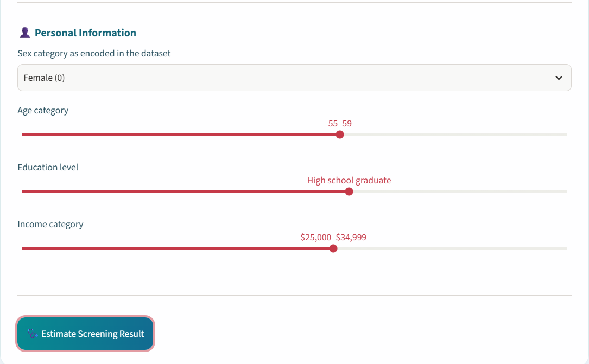
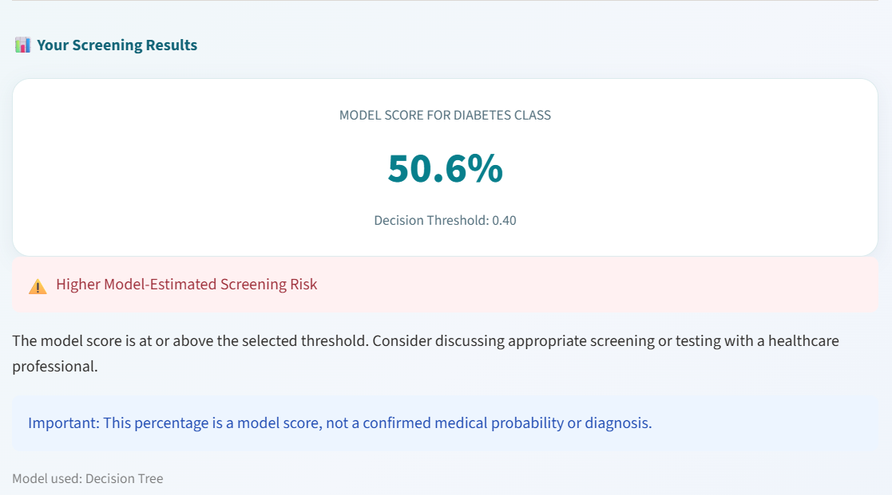

# ML-Diabetes-Risk-Screening-Tool

An end-to-end machine learning project that estimates diabetes screening risk from 21 self-reported health indicators, delivered through an interactive **Streamlit** web app.

**Disclaimer:** This project is for **educational purposes only**. It is **not** a medical diagnosis tool and does not replace laboratory testing or professional medical advice. The output is a model score, not a confirmed medical probability.

---

## Overview








The goal is to build a **screening-oriented** model: one that catches as many people at risk as possible so they can be encouraged to get proper testing. For that reason, the model was selected and tuned to maximize **recall** (sensitivity) rather than overall accuracy.

## Dataset

- **Source:** [CDC BRFSS 2015 – Diabetes Health Indicators](https://www.kaggle.com/datasets/alexteboul/diabetes-health-indicators-dataset) (`diabetes_binary_health_indicators_BRFSS2015.csv`)
- **Size:** 253,680 records, 21 features + 1 binary target
- **Class balance:** 86.07% no diabetes / 13.93% diabetes (imbalanced)
- **Missing values:** none

**Features include:** high blood pressure, high cholesterol, BMI, smoking, stroke, heart disease, physical activity, diet (fruits/veggies), alcohol use, general/mental/physical health, difficulty walking, healthcare access, sex, age group, education, and income.

## Methodology

1. **EDA** – class balance, feature distributions, diabetes rate by feature, correlation with target
2. **Stratified split** – 60% train / 20% validation / 20% test (untouched until the end)
3. **Baseline** – `DummyClassifier` (86% accuracy but 0% recall → accuracy alone is misleading here)
4. **Models compared** – Logistic Regression, Decision Tree, Random Forest, XGBoost (all with class-imbalance handling)
5. **Hyperparameter tuning** – `GridSearchCV` with 3-fold stratified CV, optimizing **recall**
6. **Model selection** – best tuned recall → **Decision Tree** (`criterion=entropy`, `max_depth=3`, `min_samples_leaf=10`)
7. **Threshold selection** – scanned thresholds 0.10–0.80; picked the one with the best precision while keeping recall ≥ 0.70 → **0.40**
8. **Refit** on train + validation, then **final evaluation** on the held-out test set

## Results (Held-out Test Set, threshold = 0.40)

| Metric | Score |
|---|---|
| Recall (Diabetes class) | **0.845** |
| Precision (Diabetes class) | 0.242 |
| F1-score | 0.376 |
| ROC-AUC | 0.777 |
| Accuracy | 0.610 |

**Confusion matrix:** TN = 24,964 · FP = 18,703 · FN = 1,093 · TP = 5,976

**Validation comparison (default settings, threshold 0.5):**

| Model | Recall | Precision | ROC-AUC |
|---|---|---|---|
| XGBoost | 0.788 | 0.306 | 0.829 |
| Logistic Regression | 0.762 | 0.311 | 0.821 |
| Decision Tree | 0.757 | 0.304 | 0.809 |
| Random Forest | 0.750 | 0.320 | 0.826 |

### Key insights & honest limitations

- The final shallow tree relies on only **4 features**: `HighBP` (~54%), `GenHlth` (~33%), `Age` (~7%), and `BMI` (~6%).
- The model deliberately favors **recall over precision**: it misses only ~15% of diabetes cases, but flags many healthy people (false positive rate ≈ 43%). This is a reasonable trade-off for *screening* (a follow-up test resolves false alarms), but not for diagnosis.
- XGBoost and Random Forest achieved higher ROC-AUC, but the simple, interpretable Decision Tree was chosen for its highest recall and transparency.
- The data is from a 2015 US survey and is self-reported, so results may not generalize to other populations.

## The App

The Streamlit app lets users answer a short questionnaire (health conditions, lifestyle, general health, personal info) and returns:

- A model score (%)
- A "higher" or "lower" screening-risk message based on the 0.40 threshold
- Clear disclaimers that the result is not a diagnosis

## Project Structure

```
.
├── app.py                          # Streamlit web app
├── diabetes_risk_model.pkl         # Saved model bundle (model, threshold, features, name)
├── Diabetes_Risk_Screening_Tool.ipynb   # Full notebook: EDA, modeling, evaluation
├── requirements.txt
└── README.md
```

## Getting Started

The app opens at https://01ab-35-227-69-234.ngrok-free.app/

## Tech Stack

Python · pandas · NumPy · scikit-learn · XGBoost · Matplotlib · joblib · Streamlit

## Future Improvements

- Probability calibration so the score better reflects real-world risk
- Cost-sensitive threshold tuning with input from domain experts
- Model explainability (SHAP) for individual predictions
- Compare against the BRFSS balanced datasets and newer survey years
- Deploy on Streamlit Community Cloud

## Author

**Hatem El-Hadary**

GitHub: https://github.com/Hatem207

LinkedIn: https://www.linkedin.com/in/hatem-el-hadary
